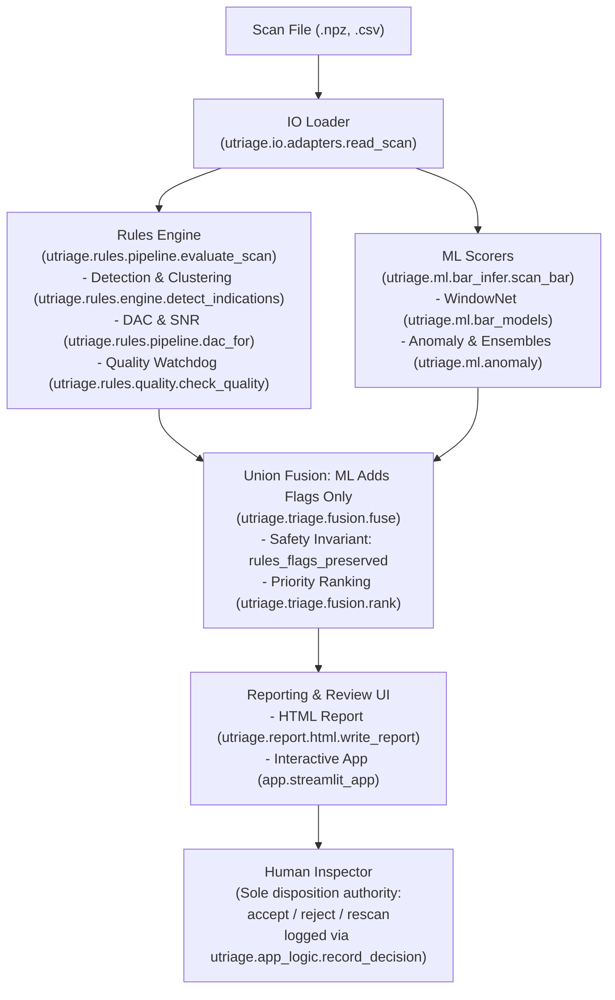

# UTriage Architecture Overview

## 1. Purpose

UTriage provides advisory offline triage for ultrasonic immersion inspections of rotating round bars and billets. It evaluates exported scan files using conventional non-destructive testing rules combined with advisory machine learning models. The system never accepts, passes, or rejects an inspection part on its own. Every final disposition remains the sole authority of the human inspector.

## 2. System Overview

UTriage processes exported ultrasonic scans through an offline pipeline. Scans are read by dedicated file adapters, evaluated in parallel by classical inspection rules and advisory machine learning scorers, combined via strict union fusion, and presented to the human inspector for disposition.

The pipeline executes strictly offline with zero external network connectivity:
- The IO loader reads scan cubes and metadata into memory.
- The rules engine computes interface gates, distance-amplitude correction (DAC) curves, signal-to-noise ratios (SNR), and data quality checks.
- Machine learning models run windowed waveform evaluations across the bar to generate candidate detection scores and uncertainty values.
- Union fusion attaches ML findings to rules indications or appends extra candidate flags. Rules flags are never dropped or reclassified.
- The reporting layer outputs self-contained HTML reports or populates the local Streamlit review application.
- The human inspector inspects the indications and records dispositions into an append-only audit trail.

## 3. Package Map

The core library is organized into eight subpackages under `src/utriage`:

| Package | Responsibility | Key Modules and Functions |
| :--- | :--- | :--- |
| `utriage.imaging` | Total Focusing Method (TFM) reconstruction and Full Matrix Capture (FMC) simulation for linear contact arrays (Synthetic data). | `utriage.imaging.tfm` (`simulate_point_fmc`, `tfm_image`, `ArrayGeometry`) |
| `utriage.io` | Offline parsing and serialization of ultrasonic scan formats and file security checks. | `utriage.io.adapters` (`read_scan`, `write_csv`, `ScanAdapter`, `NpzAdapter`, `CsvAscanAdapter`), `utriage.io.validate` (`check_file_size`, `safe_filename`), `utriage.io.ndt_ml_flaw` (`read_meta`, `iter_images`, `to_mlndt_like`) |
| `utriage.ml` | Advisory machine learning models, windowed waveform classification, anomaly detection, representation learning, and site adaptation. | `utriage.ml.bar_infer` (`load_window_model`, `scan_bar`), `utriage.ml.bar_models` (`WindowNet`, `flaw_logit`), `utriage.ml.anomaly` (`ConvAE2D`, `anomaly_score`), `utriage.ml.site_adapt` (`fit_site_stats`, `calibrate_site_threshold`), `utriage.ml.train` (`pick_device`) |
| `utriage.physics` | Immersion ultrasonic bar testing simulation, wave propagation physics, DAC calibration, domain randomization, and titanium structured grain noise models (Synthetic data). | `utriage.physics.simulator` (`simulate_bar`, `load_material`, `load_probe`, `BarScan`, `BarSpec`), `utriage.physics.calibration` (`simulate_calibration_block`, `dac_curve`), `utriage.physics.ti_noise` (`simulate_ti_bar`, `strength_field`), `utriage.physics.ti_calibration` (`calibrate_zones`, `signal_a`, `noise_stats`) |
| `utriage.pod` | Probability of Detection (POD) statistical modeling, hit/miss logistic regression, â-vs-a signal response regression, and a90/95 reliability estimation. | `utriage.pod.hitmiss` (`fit_hitmiss`, `pod_curve`, `pod_lower_bound`), `utriage.pod.ahat` (`fit_ahat`, `ahat_pod`), `utriage.pod.metrics` (`clopper_pearson`, `detection_summary`, `expected_calibration_error`) |
| `utriage.report` | Standalone offline HTML report rendering, audit summaries, titanium mode inspection reporting, and claim synthesis. | `utriage.report.html` (`render_report`, `write_report`, `ReportInput`, `Decision`), `utriage.report.ti_report` (`render_ti_report`, `write_ti_report`, `TiReportInput`), `utriage.report.claims` (`build_claims`, `render_markdown`) |
| `utriage.rules` | Classical non-destructive testing rules evaluation: gates, DAC curves, amplitude thresholds, clustering, multiple/linear limits, and data quality checks. | `utriage.rules.pipeline` (`evaluate_scan`, `dac_for`, `Evaluation`), `utriage.rules.engine` (`detect_indications`, `interface_times`, `amplitude_map`, `label_clusters`, `local_snr`), `utriage.rules.quality` (`check_quality`, `QualityReport`, `QualityFault`), `utriage.rules.zones` (`zone_alarms`, `to_indications`, `ZoneGate`, `ZoneAlarm`), `utriage.rules.config` (`load_acceptance`, `AcceptanceConfig`) |
| `utriage.triage` | Union fusion between conventional rules indications and ML findings, triage priority ranking, hybrid scoring, and uncertainty estimation. | `utriage.triage.fusion` (`fuse`, `rank`, `rules_flags_preserved`, `FusionConfig`, `MlFinding`, `TriageItem`), `utriage.triage.hybrid` (`fused_score`, `or_union`, `quantile_threshold`), `utriage.triage.uncertainty` (`ensemble_stats`) |

Top-level orchestration is handled by:
- `utriage.workflow`: Batch and single-scan offline workflows (`run_triage`, `run_batch`, `TriageJob`).
- `utriage.ti_workflow`: Titanium inspection workflow (`inspect_ti`, `load_ti_configs`, `TiInspection`).
- `utriage.app_logic`: Session management and inspector actions (`load_session`, `record_decision`, `Session`).
- `utriage.audit`: Cryptographic append-only decision audit logging (`append_entry`).
- `utriage.integrity`: SHA-256 configuration checksum checks (`require_locked`).
- `utriage.cli`: Command-line interface subcommands (`simulate`, `evaluate`, `triage`, `site-calibrate`, `ti-inspect`, `version`).
- `app.streamlit_app`: Local offline review user interface.

## 4. Safety Invariants

UTriage is built around two core architectural safety invariants:

### ML Only Adds Flags

Conventional rules remain the primary baseline authority. Machine learning operates in an advisory role only:
- In `src/utriage/triage/fusion.py`, the `fuse` function takes rule indications and ML findings. Every rule indication is preserved in full (`source="rules"`). Its category is never downgraded, suppressed, or dismissed.
- High-scoring ML findings that do not match an existing rule indication are appended as advisory items (`source="ml"`, `category="ml_flag"`).
- When an ML finding matches a rule indication, it only attaches review annotations (`uncertain` or `likely_grain_noise_opinion`). The rule's original categorization remains unchanged.
- The invariant check function `rules_flags_preserved` (`src/utriage/triage/fusion.py`) checks that every rule indication appears exactly once in the output with identical attributes.
- In titanium inspection (`src/utriage/ti_workflow.py`, `inspect_ti`), the system explicitly checks `rules_flags_preserved` and raises a `RuntimeError` if any rule flag was altered.
- This safety invariant is checked by property-based testing in `tests/test_fusion.py` (`test_property_fusion_safety`), which runs 10,000 Hypothesis iterations across randomized indication sets and ML findings.

### Never Passes a Part

UTriage possesses no automated acceptance or clearing logic:
- The system never outputs a disposition decision on its own.
- In `src/utriage/workflow.py`, offline triage summaries and HTML reports are initialized with empty decision lists (`decisions=[]`).
- In `src/utriage/app_logic.py`, `load_session` creates sessions with `decisions=[]`.
- Reports generated by `src/utriage/report/html.py` and `src/utriage/report/ti_report.py` display an advisory banner stating that decisions belong to the inspector, leaving decision fields blank for human review and sign-off.
- Dispositions must be entered manually by a human inspector through `record_decision` in `src/utriage/app_logic.py` (`accepted`, `rejected`, or `rescan`) and are recorded in an append-only audit log via `src/utriage/audit.py`.
- Automated checks in `tests/test_ti_report.py` (`test_no_prefilled_inspector_decisions`) and `tests/test_workflow.py` check that reports never contain pre-filled inspector decisions.

## 5. Titanium Mode

Titanium billet and bar inspections present severe acoustic challenges due to coarse microstructural grain noise and macrozones (spatially correlated acoustic scattering from similarly oriented grains). UTriage provides a dedicated titanium inspection path (UTriage-Ti):

- **Structured Grain Noise Simulation**: In `src/utriage/physics/ti_noise.py` (`simulate_ti_bar`), scattering is simulated using a lognormal spatial multiplier field with axial and angular correlation lengths, combined with depth-dependent noise levels across radial zones. All titanium outputs are labelled **Synthetic data**.
- **Zone-Wise Reference Calibration**: Instead of a global threshold across the bar radius, `src/utriage/physics/ti_calibration.py` (`calibrate_zones`) calibrates depth zones independently using a simulated reference block containing flat-bottom holes (FBH).
- **Zone Evaluation**: For each depth zone, the calibration computes:
  - Reference signal $A$: mean of peak pixels around the reference hole (`signal_window_px`).
  - Noise floor $B$ and peak noise $C$: estimated in the zone noise region (`noise_exclude_px`).
  - Signal-to-noise ratio: $\text{SNR} = (A - B) / (C - B)$.
  - Alarm threshold: $\text{Alarm} = \min(C \times (1 + \text{noise\_margin}), \text{cap\_fraction} \times A)$.
- **Inspectability Gate**: If a zone alarm does not exceed peak noise $C$, or if zone SNR is below `min_snr`, the zone is marked `zone_not_inspectable` for the human inspector. The zone is never silently cleared.
- **Workflow & Traceability**: In `src/utriage/ti_workflow.py` (`inspect_ti`), zone alarms are converted into rule indications via `to_indications` and fused with ML findings. Each zone alarm preserves calibration identifiers and configuration hashes for traceability.
- **Configuration Placeholders**: All settings in `configs/ti_mode.yaml` are simulator model choices and placeholders (placeholder, UNVERIFIED - Ruri to check):
  - `corr_axial_mm: 6.0` (placeholder, UNVERIFIED - Ruri to check)
  - `corr_angle_deg: 15.0` (placeholder, UNVERIFIED - Ruri to check)
  - `field_sigma: 0.1` (placeholder, UNVERIFIED - Ruri to check)
  - `zone_edges_mm: [2.0, 12.0, 22.0, 36.0]` (placeholder, UNVERIFIED - Ruri to check)
  - `zone_levels: [1.0, 1.2, 1.1]` (placeholder, UNVERIFIED - Ruri to check)
  - `ref_fbh_mm: 0.8` (placeholder, UNVERIFIED - Ruri to check)
  - `signal_window_px: 1` (placeholder, UNVERIFIED - Ruri to check)
  - `noise_exclude_px: 6` (placeholder, UNVERIFIED - Ruri to check)
  - `noise_margin: 0.10` (placeholder, UNVERIFIED - Ruri to check)
  - `cap_fraction: 0.70` (placeholder, UNVERIFIED - Ruri to check)
  - `min_snr: 2.0` (placeholder, UNVERIFIED - Ruri to check)
  - `block_seed: 1000` (placeholder, UNVERIFIED - Ruri to check)

## 6. Configuration

System behavior is controlled by configuration files in `configs/`:

- `configs/acceptance.yaml`:
  Defines conventional rules engine parameters: interface and back-wall gate offsets, amplitude recording and rejection thresholds relative to DAC, multiple indication proximity windows and maximum counts, maximum linear indication length, SNR calculation parameters, and acoustic data quality limits (waterpath tolerance, interface drop, back-wall drop, noise limit, coverage floor, saturation level, early echo). All acceptance limits are placeholders (placeholder, UNVERIFIED - Ruri to check).
- `configs/detectors.yaml`:
  Defines ML detector parameters: supervised decision thresholds, anomaly detector false call rate targets, smoothing windows, wall echo guards, hybrid fusion modes, physics-guided linear classifier regularization and feature settings, and cross-validation seeds.
- `configs/materials.yaml`:
  Defines material acoustic properties for the physics simulator (`water`, `ti64`, `in718`, `maraging250`): longitudinal velocity, density, attenuation slope, and baseline grain noise. Values are typical handbook values or simulator model choices (placeholder, UNVERIFIED - Ruri to check).
- `configs/probe.yaml`:
  Defines immersion probe and acquisition settings (`p5` 5 MHz, `p10` 10 MHz): centre frequency, fractional bandwidth, water path, focal depth in metal, focal zone half-length, beam width, sampling frequency, electronic noise level, and reference reflector gain constant (placeholder, UNVERIFIED - Ruri to check).
- `configs/randomization.yaml`:
  Defines domain randomization parameter ranges for synthetic training data generation (velocity, attenuation, grain noise, frequency, bandwidth, focal depth, water path, bar diameter, gain, reflector sizes/depths, and artefact probabilities). Documents unsupported dimensions such as reflector tilt and coupling drift. Output is Synthetic data (all ranges are placeholder, UNVERIFIED - Ruri to check).
- `configs/ti_mode.yaml`:
  Defines titanium mode parameters for structured grain noise simulation and zone-wise reference block calibration. All values are simulator model choices and placeholders (placeholder, UNVERIFIED - Ruri to check). Output is Synthetic data.
- `configs/manifest.json`:
  Contains cryptographic SHA-256 checksums of core configuration files (`configs/acceptance.yaml`, `configs/detectors.yaml`, `configs/materials.yaml`, `configs/probe.yaml`), checked via `src/utriage/integrity.py` (`require_locked`) to prevent unrecorded parameter modifications.

## 7. Extending

To extend UTriage, update the following paths:

- **Adding a new rule**:
  - Add the rule evaluation logic in `src/utriage/rules/engine.py` (for indication checks, amplitude limits, clustering, or geometry) or `src/utriage/rules/quality.py` (for scan-level data quality watchdog checks).
  - Add configuration fields to `AcceptanceConfig` in `src/utriage/rules/config.py` and default values in `configs/acceptance.yaml`.
  - Wire the rule into `evaluate_scan` in `src/utriage/rules/pipeline.py`.
- **Adding a new scan format**:
  - Implement a class conforming to the `ScanAdapter` protocol (`can_read`, `read`) in `src/utriage/io/adapters.py`.
  - Register the new adapter instance in the `ADAPTERS` tuple in `src/utriage/io/adapters.py`.
  - If custom parsing helpers are required, place them in `src/utriage/io/`.
- **Adding a new ML scorer**:
  - Implement the PyTorch neural network architecture in `src/utriage/ml/bar_models.py` (for 1D windowed waveform networks) or `src/utriage/ml/models.py` / `src/utriage/ml/anomaly.py` (for 2D slice or autoencoder models).
  - Integrate feature extraction and candidate generation into `src/utriage/ml/bar_infer.py` to produce `MlFinding` dataclasses.
  - Define hyperparameters and threshold defaults in `configs/detectors.yaml` and parse them in `src/utriage/detector_config.py`.

## 8. Further Reading

- [Architecture Decisions](decisions/)
- [Study Notes](study/)
- [Safety Case](safety-case.md)
- [Technical Note](technical-note.md)
- [Experimental Claims Summary](../results/claims.md)
- [Project Overview and Results](../README.md#results)
