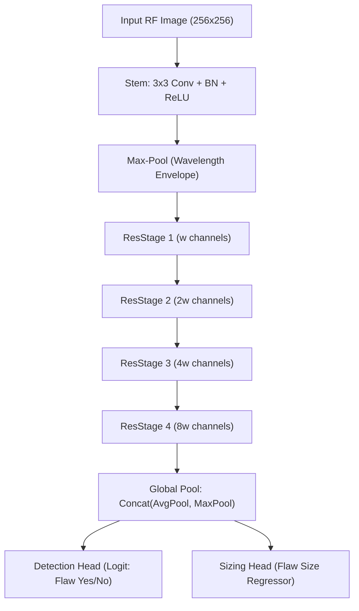
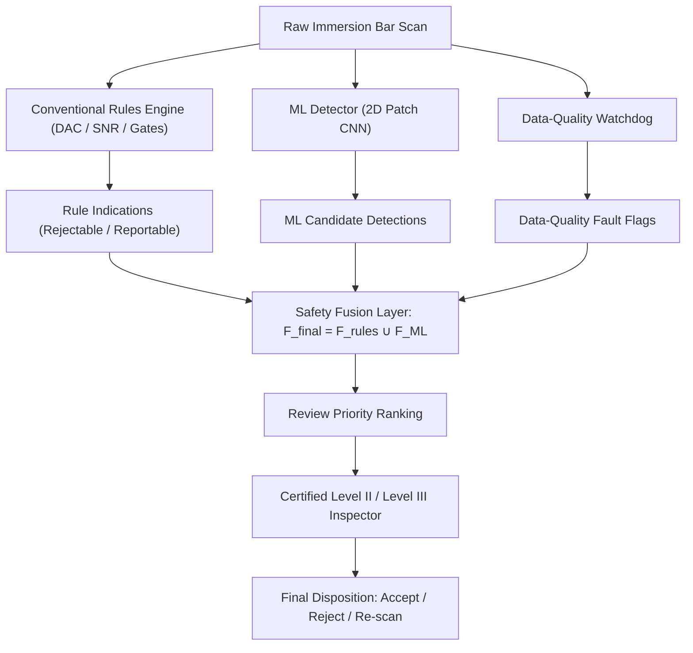

# Technical Note: AI-Assisted Ultrasonic Indication Triage Architecture, Physics Simulator, and POD Evaluation

**Document ID:** UTRIAGE-TN-2026-01  
**Target Audience:** ASNT / NAS 410 UT Level III Examiners, Aerospace NDT Quality Engineers  
**Classification:** Technical Architecture & Decision Support Specification  
**Status:** Pre-qualification / Advisory Research Baseline  

---

## 1. Introduction & Operational Context

In automated immersion ultrasonic testing (UT) of aerospace-grade titanium (e.g., Ti-6Al-4V) and nickel-base superalloys (e.g., Inconel 718) round bars and billets (8–300 mm diameter, up to 6 m length), inspection systems must reliably detect internal discontinuities down to fine calibration limits, typically 0.8 mm flat-bottom-hole (FBH) equivalence [V1]. 

However, coarse grain structures, prior beta grain boundaries, and microstructural texture induce acoustic scattering in the Rayleigh and stochastic scattering regimes [V2]. This scattering manifests as high-amplitude, spatially varying background grain noise on the RF A-scan. 

Under conventional threshold-based evaluation, grain-noise peaks frequently breach recording and rejection thresholds, resulting in high false-call rates, inspector fatigue, and prolonged manual A-scan review [V2]. Furthermore, subtle acoustic anomalies—such as transient air bubbles, surface roughness, water-path drift, or loss of back-wall reflection—are often detected only during post-scan evaluation, necessitating costly bar re-chucking and re-scanning [V3].

UTriage is designed as an offline, advisory decision-support system to address these bottlenecks. Its core objectives are:
1. Provide objective, repeatable indication measurement, clustering, and local signal-to-noise ratio (SNR) computation.
2. Separate likely grain noise from genuine flaw reflections using calibrated machine learning (ML) models operating under strict statistical confidence guarantees.
3. Catch acquisition data-quality faults during or immediately following scanning via a dedicated watchdog.
4. Pre-fill standard inspection records to minimize transcription effort without reducing inspection reliability.

### Non-Negotiable Operational & Safety Boundaries
In accordance with aerospace quality governance:
- **Rules remain in charge:** The conventional code-based rules engine (gating, Distance-Amplitude Correction [DAC], reference FBH comparison, and SNR thresholding) represents the foundational authority.
- **ML can only add flags:** Machine learning models are structurally restricted to adding candidate indications that conventional thresholding missed. ML has zero software authority to suppress, downgrade, or clear any rule-flagged indication.
- **Certified inspector authority:** UTriage is an advisory tool and never accepts, passes, or certifies a component. Every final disposition remains the legal and technical responsibility of the certified Level II / Level III inspector.
- **Air-gapped and offline:** The software operates offline on exported scan files and never connects physically or digitally to UT pulser-receivers, machine controllers, or plant PLCs.

---

## 2. Physics-Based Ultrasonic Simulator & Modelling Assumptions

To build and benchmark detection algorithms with verifiable ground truth, a physics-based immersion UT simulator for rotating round metal bars was implemented (`src/utriage/physics/simulator.py`). 

### 2.1 Forward Model Formulation
The simulator computes synthetic RF A-scans using a 1D ray-convolution model coupled with analytical acoustic beam profiles.

#### Time of Flight & Geometry
For an immersion probe located in water at water path $w$ from the surface of a cylindrical bar of diameter $D$:
- Longitudinal wave velocities are $c_w$ (water) and $c_m$ (metal).
- Front-wall interface reflection arrives at:
  $$t_{if} = \frac{2w}{c_w}$$
- An internal reflector at metal depth $z$ below the cylindrical surface arrives at:
  $$t(z) = t_{if} + \frac{2z}{c_m}$$
- The first back-wall echo from the opposite side of the bar arrives at $t(D) = t_{if} + 2D / c_m$.

#### Transducer Pulse Model
The ultrasonic excitation is modelled as a Gaussian-modulated cosine pulse centered at frequency $f_c$:
$$p(t) = \exp\left(-\frac{t^2}{2s^2}\right) \cos(2\pi f_c t)$$
Given the fractional $-6\text{ dB}$ bandwidth $b$ (e.g., $0.6$ for 60% bandwidth):
$$\sigma_f = \frac{b \cdot f_c}{2\sqrt{2\ln 2}}, \quad s = \frac{1}{2\pi \sigma_f}$$

#### Acoustic Interface Reflection & Transmission
For acoustic impedances $Z_1 = \rho_1 c_1$ and $Z_2 = \rho_2 c_2$, normal-incidence reflection and round-trip transmission coefficients are:
$$R = \frac{Z_2 - Z_1}{Z_2 + Z_1}, \quad T_{rt} = 1 - R^2 = \frac{4 Z_1 Z_2}{(Z_1 + Z_2)^2}$$
For water-to-metal interfaces ($R \approx 0.9$), the interface echo represents the dominant reflection.

#### Material Attenuation
Attenuation is modelled using a linear-frequency law:
$$\alpha_{\text{dB}} = a \cdot f_c \quad [\text{dB/mm}]$$
$$A(z) = 10^{-\frac{2 \alpha_{\text{dB}} z}{20}}$$

#### Sound Field & Focusing Profile
A focused transducer is modelled with an on-axis Lorentzian focal gain profile $G(z)$ and a lateral Gaussian sensitivity profile:
$$G(z) = \frac{1}{\sqrt{1 + \left(\frac{z - z_f}{z_R}\right)^2}}$$
For a reflector located at axial offset $\Delta x$ and angular offset $\Delta\theta$ from the beam axis at radius $\rho = R_{\text{bar}} - z$, the effective lateral beam distance $r$ is:
$$r^2 = \Delta x^2 + (\rho \Delta\theta)^2$$
The lateral beam sensitivity is weighted by $\exp\left(-\frac{r^2}{2\sigma_b^2}\right)$, where $\sigma_b$ represents the lateral beam waist radius.

#### Reflector Models
1. **Flat-Bottom Hole (FBH):** Echo amplitude follows the classic far-field disc reflector area scaling ($d^2$):
   $$A_{\text{fbh}} = k_{\text{fbh}} \cdot \left(\frac{d}{1\,\text{mm}}\right)^2 \cdot T_{rt} \cdot A(z) \cdot G(z)$$
   where $k_{\text{fbh}}$ is a calibrated simulator gain constant.
2. **Inclusions:** Non-metallic inclusions (oxides, nitrides) are modelled with an amplitude reduction factor $u \in [u_{\text{min}}, 1.0]$ applied to the FBH law, with reflections partitioned across three discrete facets (delays: $0.0$, $0.35$, and $0.70$ periods; amplitude weights: $1.0$, $-0.6$, and $0.4$) to simulate irregular split-peak phase interference.

#### Grain Noise & Receiver Model
Grain backscatter is synthesized by convolving dense white Gaussian noise $n(t)$ with the transducer pulse $p(t)$, shaped by depth-dependent attenuation and focal gain:
$$g(t) = \sigma_g \cdot \left(\frac{f_c}{5\,\text{MHz}}\right)^2 \cdot [n \ast p](t) \cdot T_{rt} \cdot A(z(t)) \cdot G(z(t)) \quad \text{for } t > t_{if}$$
where $\sigma_g$ is a material-specific grain scattering parameter.

The composite RF signal incorporates white Gaussian electronic noise $e(t)$ and receiver gain:
$$s(t) = 10^{\frac{\text{gain}_{\text{dB}}}{20}} \left[ s_{\text{interface}}(t) + s_{\text{flaws}}(t) + g(t) + s_{\text{backwall}}(t) \right] + e(t)$$
Signal saturation is enforced by clipping at receiver full scale $[-1.0, 1.0]$.

### 2.2 Modelling Simplifications (ADR 0003)
As formally documented in [ADR 0003](file:///docs/decisions/0003-simulator-assumptions.md), the simulator adopts deliberate physical simplifications to maintain computational tractability and deterministic testing:
1. **No elastodynamic numerical solver:** Wave propagation uses 1D ray-convolution rather than full 3D Finite Element (FE) or Finite-Difference Time-Domain (FDTD) solvers. Diffraction and creeping waves are omitted.
2. **No mode conversion or shear waves:** Only normal-incidence longitudinal pressure waves are modelled. Shear-wave mode conversions at curved bar boundaries are not tracked.
3. **Curved bar surface approximated as flat for transmission:** Cylindrical acoustic lens refractions and circumferential beam distortions are simplified.
4. **Independent grain backscatter:** Grain backscatter is computed independently per A-scan without 3D spatial speckle correlation across adjacent helical scan passes.
5. **Linear attenuation:** Polycrystalline Rayleigh ($f^4$) and stochastic ($f^2$) scattering regimes are approximated by a linear frequency loss.
6. **Heuristic acquisition artefacts:** Coupling faults, air bubbles, and surface roughness are simulated via parametric regional multipliers.
7. **Unverified material constants:** Material acoustic velocities and attenuation values are handbook approximations flagged `UNVERIFIED — Ruri to check`.

**Consequence for Validation:** All simulator outputs, metrics, and figures are strictly labelled **"Synthetic data"**. They serve to verify algorithm logic, clustering, and relative ranking, but cannot be used for production qualification.

---

## 3. Conventional Rules Engine Baseline & Data-Quality Watchdog

The conventional rules engine (`src/utriage/rules/engine.py`) and watchdog (`src/utriage/rules/quality.py`) replicate standardized code-based UT evaluation.

### 3.1 Interface Gating & Gate Synchronization
To compensate for mechanical bar runout and water-path variation, gates are synchronized dynamically to the interface echo. For each A-scan, the analytic Hilbert envelope is computed:
$$e(t) = |s(t) + j \mathcal{H}\{s(t)\}|$$
The interface time $t_{if}$ is identified as the first point crossing threshold $\theta_{if}$:
$$t_{if} = \min \{ t : e(t) \ge \theta_{if} \}$$
Inspection gates are established relative to $t_{if}$:
- **Front-surface dead zone:** $[0, z_{\text{dead}})$, where interface ring-down obscures echoes.
- **Flaw evaluation gate:** $[z_{\text{dead}}, D - z_{\text{back}})$.
- **Back-wall gate:** $[D - z_{\text{back}}, D + z_{\text{back}}]$, verifying transmission through the bar thickness.

### 3.2 Distance-Amplitude Correction (DAC)
A Distance-Amplitude Correction curve $A_{\text{ref}}(z)$ is generated by scanning calibration reference blocks containing known FBH targets across multiple metal paths. Indication amplitudes are evaluated in percent DAC:
$$a\%(z) = 100 \cdot \frac{e_{\text{peak}}(z)}{A_{\text{ref}}(z)}$$
where $100\%$ DAC corresponds exactly to the reference FBH echo height at that specific metal path.

### 3.3 Local Signal-to-Noise Ratio (SNR)
Because grain backscatter varies with depth and alloy microstructure, SNR is calculated locally. For an indication peak $e_{\text{peak}}$ at depth $z_0$, envelope samples in adjacent A-scans within depth band $|z - z_0| \le w_{\text{noise}}$ are extracted, strictly excluding the indication echo core $|z - z_0| \le w_{\text{excl}}$. Computing root-mean-square noise $n_{\text{rms}}$ over this local window yields:
$$\text{SNR}_{\text{dB}} = 20 \log_{10}\left(\frac{e_{\text{peak}}}{n_{\text{rms}}}\right)$$

### 3.4 3D Indication Clustering & Categorization
A-scans with amplitudes exceeding recording thresholds are clustered into discrete indications using 8-connectivity across the axial coordinate and circumferential angle (incorporating $360^\circ$ toroidal wrap-around). Clustered indications are classified into four mutual categories per `configs/acceptance.yaml`:
- **Rejectable:** $a\% \ge \text{reject\_pct}$, or indication length $\ge \text{max\_length\_mm}$, or multiple indications within neighbor proximity limits.
- **Reportable:** $\text{record\_pct} \le a\% < \text{reject\_pct}$.
- **Insignificant:** $a\% < \text{record\_pct}$.
- **Data-quality fault:** Acquisition regions flagged as corrupted by the watchdog.

*(Note: Threshold values in `configs/acceptance.yaml` are explicitly designated as unverified placeholders. No proprietary tables from AMS-STD-2154 or ASTM E2375 are assumed).*

### 3.5 Data-Quality Watchdog
The watchdog checks every A-scan across seven failure modes:
1. **Interface missing:** No sample crosses $\theta_{if}$.
2. **Water-path drift:** Interface time deviates from median: $|t_{if} - \text{median}(t_{if})| > \tau_{\text{tol}}$.
3. **Loss of back reflection (back-wall drop):** Back-wall echo falls below specified fraction of bar median.
4. **Excessive noise:** Median flaw-gate envelope exceeds threshold multiple of bar baseline.
5. **Coverage gap:** Consecutive zero-amplitude or dead A-scans.
6. **Receiver saturation:** Amplitude clipping at full scale.
7. **Coupling bubble / early echo:** Echo detected in the water path prior to $t_{if}$.

**Critical Safety Fix:** Data-quality faults never downgrade rejectable or reportable indications. If a fault coincides with an indication, the indication retains its severity category and appends a mandatory re-scan flag.

Baseline verification status in synthetic campaigns:
- Low-noise reference detection pass: `{{rules_baseline.json: gate.detection_rate_low_noise_at_or_above_reference}}`
- All planted artefacts caught: `{{rules_baseline.json: gate.all_artefacts_caught}}`
- Overall rules baseline gate passed: `{{rules_baseline.json: gate.passed}}`

---

## 4. Machine Learning Architectures & Virtual-Flaw Augmentation

### 4.1 Real-Data Benchmark: Residual CNN on ML-NDT (Weld Dataset)
To validate machine learning methodology on real ultrasonic RF data, a residual convolutional neural network was developed and evaluated against the public ML-NDT phased-array dataset (Virkkunen et al., arXiv:1903.11399).

#### Architecture Details
1. **Stem:** $3\times 3$ convolution, batch normalization, ReLU, followed by a max-pooling layer sized to the acoustic wavelength. As established by Virkkunen et al., early max-pooling over RF oscillations functions as an analog envelope detector, preserving peak reflection amplitudes while discarding phase sensitivity.
2. **Four Residual Stages:** Each stage contains two $3\times 3$ convolutions with skip connections, doubling channel depth ($w, 2w, 4w, 8w$) and halving spatial resolution.
3. **Dual Global Pooling:** Concatenated global average pooling (encoding background noise statistics) and global max pooling (retaining sharp crack-tip diffraction peaks).
4. **Multi-Task Heads:**
   - Classification head: outputs logit for flaw detection.
   - Sizing head: regresses equivalent flaw dimension (trained exclusively on flawed samples with smooth L1 loss).

#### Training Protocol & Results
Training used AdamW with cosine learning rate scheduling and three random restarts to address initialisation sensitivity. Evaluated on whole held-out batches:
- Parameter count: `{{mlndt_metrics.json: params}}`
- Training dataset size: `{{mlndt_metrics.json: splits.train.image_count}}` images
- Test dataset size: `{{mlndt_metrics.json: splits.test.image_count}}` images
- Test flaw detection: `{{mlndt_metrics.json: per_split.test.detection.n_hit}}` of `{{mlndt_metrics.json: per_split.test.detection.n_flawed}}` detected
- Clopper-Pearson 95% lower confidence bound of detection: `{{mlndt_metrics.json: per_split.test.detection.pod_lower95}}`
- False calls on unflawed test scans: `{{mlndt_metrics.json: per_split.test.false_calls.n_false}}` on `{{mlndt_metrics.json: per_split.test.false_calls.n}}` images (FCR = `{{mlndt_metrics.json: per_split.test.false_calls.rate}}`, upper 95% bound = `{{mlndt_metrics.json: per_split.test.false_calls.upper95}}`)
- Single-sample CPU latency: `{{mlndt_metrics.json: latency_ms.cpu_batch_1}}` ms
- Single-sample GPU latency: `{{mlndt_metrics.json: latency_ms.gpu_batch_1}}` ms

*Methodological Limitation:* The ML-NDT dataset contains only three physical fatigue cracks in an austenitic 316L pipe weld, augmented into multiple scans. Held-out batches contain augmented variants of the same three physical cracks. This experiment validates the deep learning architecture and POD evaluation method, but does not constitute validation on aerospace bars.

### 4.2 Bar-Domain ML: A-Scan Windows & Spatiotemporal Patches
For bar immersion inspection, candidates are evaluated using DAC-normalized windows of $L = 128$ samples centered at depth $z_0$:
$$x(t) = \frac{s(t)}{A_{\text{ref}}(z_0)}$$
Two input configurations were benchmarked:
1. **1D A-Scan Model:** Single RF waveform channel along the beam axis.
2. **2D Spatiotemporal Patch Model:** A $3\times 3$ grid of neighbouring A-scans across axial translation and circumferential rotation (9 channels). While grain backscatter exhibits spatial independence in the 1D simulator, genuine reflectors spread energy into adjacent scan lines following the Gaussian lateral beam profile $\exp(-r^2 / 2\sigma_b^2)$.

### 4.3 Virtual-Flaw Augmentation
Following the virtual-flaw augmentation principle from Virkkunen et al.:
- Synthetic flaw reflections (modelled FBH or multi-faceted inclusions) are linearly injected into unflawed, noise-only windows extracted from simulated bars across varying depths and grain-noise levels.
- To prevent the model from learning numerical boundary artefacts or insertion signatures, unflawed negative samples pass through the exact same processing pipeline with zero-amplitude injection.
- Testing is performed strictly on fully simulated bars with natural embedded reflectors, ensuring realistic spatial continuity.

Model selection outcome (`results/bar_domain_metrics.json`):
- Kept architecture: `{{bar_domain_metrics.json: kept_model.choice}}`
- Selection rationale: `{{bar_domain_metrics.json: kept_model.reason}}`
- Training sample volume: `{{bar_domain_metrics.json: train_sizes.n_train_2d}}` windows

---

## 5. Probability of Detection (POD) Methodologies

In safety-critical NDT, models cannot be evaluated using generic machine learning metrics (such as accuracy or ROC-AUC). Detection reliability must be quantified using Probability of Detection (POD) and $a_{90/95}$ metrics per MIL-HDBK-1823A.

### 5.1 Hit/Miss POD Formulation
For discrete binary inspection outcomes $y_i \in \{0, 1\}$ on flaws of size $a_i$, the detection probability is modelled using a logistic generalized linear model (GLM) on log flaw dimension:
$$\text{POD}(a) = \frac{1}{1 + \exp\left(-(\beta_0 + \beta_1 \ln a)\right)}$$
Parameters $\boldsymbol{\beta} = (\beta_0, \beta_1)^T$ are estimated via maximum likelihood:
$$\ell(\boldsymbol{\beta}) = \sum_{i=1}^N \left[ y_i \ln \text{POD}(a_i) + (1 - y_i) \ln (1 - \text{POD}(a_i)) \right]$$

The characteristic detection dimensions are obtained by inverting the link function:
$$\ln a_p = \frac{\text{logit}(p) - \beta_0}{\beta_1}, \quad a_{50} = \exp\left(-\frac{\beta_0}{\beta_1}\right), \quad a_{90} = \exp\left(\frac{\ln 9 - \beta_0}{\beta_1}\right)$$

#### One-Sided 95% Confidence Bound ($a_{90/95}$) via the Delta Method
Let $\boldsymbol{\Sigma}$ denote the parameter covariance matrix (the inverse of the observed Fisher information matrix $\boldsymbol{I}(\hat{\boldsymbol{\beta}})$). For $g(\boldsymbol{\beta}) = \ln a_{90} = \frac{\ln 9 - \beta_0}{\beta_1}$:
$$\nabla g = \begin{pmatrix} -\frac{1}{\beta_1} \\ -\frac{\ln 9 - \beta_0}{\beta_1^2} \end{pmatrix}$$
$$\text{Var}(\ln a_{90}) \approx \nabla g^T \boldsymbol{\Sigma} \nabla g$$
The one-sided 95% upper confidence bound is computed as:
$$a_{90/95} = \exp\left( \ln \hat{a}_{90} + 1.645 \sqrt{\text{Var}(\ln a_{90})} \right)$$

#### False-Call Rate (FCR) & The Rule of Three
On $n$ unflawed inspection windows, the false-call rate is $\text{FCR} = k / n$. When zero false calls are observed ($k = 0$), the one-sided 95% upper confidence bound on the false-call probability is governed by the Rule of Three:
$$p_{\text{upper}, 95\%} \approx \frac{-\ln(0.05)}{n} \approx \frac{2.996}{n} \approx \frac{3}{n}$$
This underscores why observing zero false calls on small test samples ($n \le 100$) provides insufficient statistical assurance for plant operations.

### 5.2 Continuous Signal-Response ($\hat{a}$-versus-$a$) POD
For the conventional rules engine, the output is a continuous signal response $\hat{a}$ (peak % DAC amplitude). The relationship between flaw size $a$ and measured response $\hat{a}$ follows:
$$\ln \hat{a} = \beta_0 + \beta_1 \ln a + \varepsilon, \quad \varepsilon \sim \mathcal{N}(0, \sigma^2)$$

#### Tobit Censored Likelihood
To prevent regression bias arising from physical instrument limits, responses below the recording floor $\hat{a}_{\text{low}}$ are treated as left-censored, and saturated responses at $\hat{a}_{\text{high}}$ are treated as right-censored. The parameters $\boldsymbol{\theta} = (\beta_0, \beta_1, \ln\sigma)^T$ are estimated by maximizing the censored likelihood:
$$\ell(\boldsymbol{\theta}) = \sum_{\text{uncensored}} \ln\left[\frac{1}{\sigma}\phi\left(\frac{\ln\hat{a}_i - \mu_i}{\sigma}\right)\right] + \sum_{\text{left}} \ln\Phi\left(\frac{\ln\hat{a}_{\text{low}} - \mu_i}{\sigma}\right) + \sum_{\text{right}} \ln\left[1 - \Phi\left(\frac{\ln\hat{a}_{\text{high}} - \mu_i}{\sigma}\right)\right]$$
where $\mu_i = \beta_0 + \beta_1 \ln a_i$, and $\phi, \Phi$ are the standard normal PDF and CDF.

#### Transition to POD
For an amplitude decision threshold $\hat{a}_{\text{dec}}$ (e.g., $50\%$ DAC):
$$\text{POD}(a) = P(\hat{a} > \hat{a}_{\text{dec}}) = \Phi\left( \frac{\beta_0 + \beta_1 \ln a - \ln\hat{a}_{\text{dec}}}{\sigma} \right)$$
$$a_{50} = \exp\left(\frac{\ln\hat{a}_{\text{dec}} - \beta_0}{\beta_1}\right), \quad a_{90} = \exp\left(\frac{\ln\hat{a}_{\text{dec}} - \beta_0 + 1.2816\sigma}{\beta_1}\right)$$
The corresponding $a_{90/95}$ bound is derived via the delta method over the parameter covariance matrix $\boldsymbol{\Sigma}_{\boldsymbol{\theta}}$.

Continuous $\hat{a}$-vs-$a$ results for rules engine:
- Overall $a_{50}$: `{{bar_domain_metrics.json: ahat_rules.overall.fit.a50}}` mm
- Overall $a_{90}$: `{{bar_domain_metrics.json: ahat_rules.overall.fit.a90}}` mm
- Overall $a_{90/95}$: `{{bar_domain_metrics.json: ahat_rules.overall.fit.a90_95}}` mm
- Noise scale 2.0 $a_{90/95}$: `{{bar_domain_metrics.json: ahat_rules.per_noise.2.0.fit.a90_95}}` mm

### 5.3 Binomial Confidence Bounds Under Separation
When testing high-performance detectors on synthetic or augmented data, complete data separation frequently occurs (all flawed samples detected with zero misses, or all unflawed samples cleared). Under complete separation, the logistic likelihood fails to converge and parameter variance diverges. 

Under these conditions, a Clopper-Pearson exact one-sided 95% binomial lower confidence bound is computed over flaws $\ge$ reference size:
$$\text{POD}_{\text{lower}, 95\%} = 1 - (0.05)^{1/N}$$
This exact non-parametric bound provides a rigorous lower detection limit when GLM fitting is mathematically undefined.

### 5.4 Head-to-Head Comparison: Matched False-Call Rate
To perform an equitable comparison between conventional thresholding and ML triage, evaluation is conducted at a **matched false-call rate** on simulated Ti-6Al-4V bars under high grain noise (noise scale 2.0):
- Rules baseline false-call rate: `{{bar_domain_metrics.json: thresholds.rules_fcr.2.0}}`
- Rules hit/miss $a_{90/95}$: `{{bar_domain_metrics.json: per_method_per_noise.rules.2.0.pod_summary.pod.a90_95}}` mm
- Rules hit/miss $a_{50}$: `{{bar_domain_metrics.json: per_method_per_noise.rules.2.0.pod_summary.pod.a50}}` mm
- ML 2D patch threshold: `{{bar_domain_metrics.json: thresholds.ml_2d.2.0}}`
- ML 2D hit/miss $a_{90/95}$ at matched FCR: `{{bar_domain_metrics.json: per_method_per_noise.ml_2d.2.0.pod_summary.pod.a90_95}}` mm
- ML 2D hit/miss $a_{50}$ at matched FCR: `{{bar_domain_metrics.json: per_method_per_noise.ml_2d.2.0.pod_summary.pod.a50}}` mm

---

## 6. Decision Support, Fusion Architecture & Safety Design

The decision-support fusion engine (`src/utriage/triage/fusion.py`) combines conventional rules and machine learning detections under strict architectural safety invariants.

### 6.1 Architectural Safety Principles (ADR 0001)
1. **The Union Principle:** Final indications are formed strictly by the set union:
   $$F_{\text{final}} = F_{\text{rules}} \cup F_{\text{ML}}$$
   The ML detector is permitted to add candidate flags that rules missed. ML has no software path to dismiss, suppress, or delete any indication identified by the rules engine.
2. **Immutable Data Model:** Indications are passed through immutable frozen dataclasses (`TriageItem`, `Indication`, `MlFinding`). Attributes cannot be altered post-instantiation.
3. **Formal Property Verification:** Invariant enforcement is verified by property-based testing using Hypothesis (`tests/test_fusion.py`) across 10,000 randomized synthetic inspection campaigns:
   - Test suite: `{{triage_metrics.json: property_test}}`
   - Formal union violations observed: `{{triage_metrics.json: union_violations}}`

### 6.2 Review Priority Ranking
Indications are sorted into an evidence queue for Level II review:
1. Rejectable indications (highest % DAC or multi-indication clusters).
2. Conformal uncertain indications (`inspector review: uncertain`).
3. Borderline reportable indications accompanied by ML "likely grain noise" evidence panels.
4. Data-quality fault zones requiring immediate re-scan.

Review effort metrics on 20 simulated bars:
- Mean indications reviewed to find all flaws (Ranked Queue): `{{triage_metrics.json: ranking.operating_point.mean_effort_ranked}}`
- Mean indications reviewed under unranked review: `{{triage_metrics.json: ranking.operating_point.mean_effort_random}}`
- Flaws identified by conventional rules alone: `{{triage_metrics.json: ranking.operating_point.flaws_found_rules_only}}`
- Flaws identified under fused union: `{{triage_metrics.json: ranking.operating_point.flaws_found_union}}`
- ML-added candidate flags per bar: `{{triage_metrics.json: ranking.operating_point.ml_flag_false_calls_per_bar}}`

---

## 7. Conformal Prediction & Calibrated Uncertainty

Standard deep learning softmax outputs are notoriously overconfident and poorly calibrated under acoustic noise variations. To guarantee rigorous uncertainty quantification, UTriage integrates split conformal prediction.

### 7.1 Mathematical Foundation
Let $(X_i, Y_i)_{i=1}^n$ denote an independent calibration dataset of ultrasonic windows with true labels $Y_i \in \{0, 1\}$. For a model output probability $\hat{p}(x) = P(Y=1|X=x)$, non-conformity scores are defined as:
$$s_i = 1 - \hat{p}_{Y_i}(X_i)$$
For a user-selected significance level $\alpha \in (0, 1)$ (e.g., $\alpha = 0.10$ for 90% target coverage), the conformal quantile $\hat{q}$ is calculated:
$$\hat{q} = \text{Quantile}\left( s_1, \dots, s_n; \frac{\lceil (n+1)(1-\alpha) \rceil}{n} \right)$$

For a novel indication candidate $X_{n+1}$, the prediction set is constructed:
$$C(X_{n+1}) = \{ y \in \{0, 1\} : 1 - \hat{p}_y(X_{n+1}) \le \hat{q} \}$$
By construction, this prediction set satisfies the exact, distribution-free finite-sample coverage guarantee:
$$P(Y_{n+1} \in C(X_{n+1})) \ge 1 - \alpha$$

### 7.2 Safety Routing
When the conformal prediction set yields an ambiguous result ($C(X) = \{0, 1\}$), the system assigns the category:
$$\text{Category} = \text{inspector review: uncertain}$$
This guarantees that borderline echoes cannot be classified as grain noise without explicit human verification.

Empirical conformal calibration metrics:
- Target error rate $\alpha$: `{{triage_metrics.json: conformal.alpha}}`
- Achieved empirical coverage: `{{triage_metrics.json: conformal.coverage}}`
- Proportion of candidates routed to uncertain review: `{{triage_metrics.json: conformal.uncertain_fraction}}`
- Calibration sample size: `{{triage_metrics.json: conformal.n}}`

---

## 8. Operating Point Selection (ADR 0004)

In non-destructive testing, operating thresholds cannot be chosen by maximizing F1-score or balancing precision and recall. Detection thresholds must be statistically anchored to governing flaw sensitivity limits.

### 8.1 Statistical Search Procedure
As defined in [ADR 0004](file:///docs/decisions/0004-operating-point.md):
1. **Threshold Sweep:** Candidate ML probability thresholds $\tau$ are scanned downwards from $1.0$ (highest confidence, lowest false alarms).
2. **Statistical Lower Bound Evaluation:** At each candidate threshold, the one-sided 95% lower confidence bound of POD at the reference sensitivity ($0.8\text{ mm}$ FBH equivalence per project plan V1) is calculated on validation data using the hit/miss logistic delta method or exact binomial bounds.
3. **Threshold Selection:** The highest threshold satisfying:
   $$\text{POD}_{\text{lower}, 95\%}(0.8\,\text{mm}) \ge \text{Target} \quad (\text{default Target } = 0.90)$$
   is selected as the operational triage threshold.

Operating point metrics (`results/triage_metrics.json`):
- Operating detection threshold $\tau$: `{{triage_metrics.json: operating_point.threshold}}`
- Reference flaw dimension: `{{triage_metrics.json: operating_point.ref_size}}` mm
- Target lower bound: `{{triage_metrics.json: operating_point.target}}`
- Achieved one-sided 95% POD lower bound at reference: `{{triage_metrics.json: operating_point.pod_lower95_at_ref}}`
- Method employed: `{{triage_metrics.json: operating_point.method}}`
- Validation false-call rate at operating point: `{{triage_metrics.json: operating_point.false_call_rate}}`

---

## 9. Robustness Analysis & Sim-to-Real Domain Gap

### 9.1 Domain Shift Stress Testing
To identify operational failure boundaries, bar-domain models were subjected to severe out-of-distribution shifts (`results/robustness_metrics.json`):

1. **Noise Extrapolation ($2.5\times$ Nominal Noise):**
   - Rules baseline false-call rate: `{{robustness_metrics.json: domain_shift.noise_2.5x.rules.false_call_rate}}`
   - ML 2D patch false-call rate (matched): `{{robustness_metrics.json: domain_shift.noise_2.5x.ml_2d_matched.false_call_rate}}`
   - Rules detection rate at 0.8 mm reference: `{{robustness_metrics.json: domain_shift.noise_2.5x.rules.detection_per_size.0.8}}`
   - ML detection rate at 0.8 mm reference: `{{robustness_metrics.json: domain_shift.noise_2.5x.ml_2d_matched.detection_per_size.0.8}}`
2. **Alloy Matrix Shift (Inconel 718):**
   - Rules false-call rate: `{{robustness_metrics.json: domain_shift.in718.rules.false_call_rate}}`
   - ML false-call rate: `{{robustness_metrics.json: domain_shift.in718.ml_2d_matched.false_call_rate}}`
3. **Transducer Frequency Shift ($10\text{ MHz}$ Probe):**
   - Rules false-call rate: `{{robustness_metrics.json: domain_shift.probe_p10.rules.false_call_rate}}`
   - ML false-call rate: `{{robustness_metrics.json: domain_shift.probe_p10.ml_2d_matched.false_call_rate}}`
4. **Unseen Surface Roughness Artefact:**
   - Rules false-call rate: `{{robustness_metrics.json: unseen_artefact.rules_fcr}}`
   - ML 1D false-call rate: `{{robustness_metrics.json: unseen_artefact.p4_1d_with_roughness_fcr}}`

### 9.2 Sim-to-Real Gap Evaluation
A bidirectional sim-to-real benchmark was executed between synthetic models and the real ML-NDT weld dataset:
- ML-NDT model evaluated on simulated B-scans (ROC-AUC): `{{robustness_metrics.json: sim_to_real.mlndt_on_simulated_bscan.roc_auc}}`
- Bar-domain 1D model evaluated on ML-NDT real weld validation images (ROC-AUC): `{{robustness_metrics.json: sim_to_real.bar_1d_on_mlndt_val.roc_auc}}`

#### Physical Drivers of the Sim-to-Real Gap
The pronounced performance degradation across domains illustrates the fundamental sim-to-real gap in ultrasonic NDT:
1. **Transducer Impulse Response & Frequency Mismatch:** The ML-NDT dataset features rectified or envelope-detected phased-array sector scans from contact wedges on pipe welds, whereas bar models assume high-frequency immersion RF waveforms.
2. **Uncalibrated DAC Normalization:** Normalization in the bar domain relies on synthetic calibration block curves. Real plant data exhibits gain offsets, material attenuation scatter, and analog filtering curves that distort normalized input magnitudes.
3. **Absence of 3D Speckle Correlation in Simulation:** The 1D ray simulator generates independent grain backscatter per scan line. In real alloy bars, finite grain size and acoustic beam overlap create spatially correlated acoustic speckle across adjacent helical lines that confuses models trained on independent noise.

**Conclusion:** Purely simulator-trained models cannot be deployed directly to plant inspection lines without empirical re-calibration on plant reference blocks and sample bar scans.

---

## 10. Technical Limitations & Operational Risks

A complete risk analysis mandates explicit documentation of current limitations:

| Limitation / Risk | Technical Cause | Operational Impact | Mitigation |
|---|---|---|---|
| **Synthetic Bar Data** | Ray-convolution simulator omits 3D wave diffraction, mode conversion, and cylindrical refraction. | Models may overfit synthetic noise textures. | Union architecture: conventional rules engine remains the safety baseline. |
| **Real Dataset Scope** | ML-NDT contains only 3 physical fatigue cracks in a 316L austenitic weld. | Real-data results demonstrate methodology, not bar inspection qualification. | Plant pilot requires empirical scans on actual alloy bar products. |
| **Placeholder Acceptance Limits** | Paywalled standard specifications (AMS-STD-2154, ASTM E2375) are not reproduced. | Absolute reject/accept categories are unverified placeholders. | Plant Level III must configure site-specific acceptance parameters in `configs/acceptance.yaml`. |
| **Transducer Dead Zones** | Near-surface interface echo ring-down obscures shallow defects. | Defects in the front-surface dead zone $[0, z_{\text{dead}})$ cannot be resolved. | Preserved dead-zone gating; surface zones inspected via complementary NDT methods (eddy current / fluorescent penetrant). |

---

## 11. Prerequisites & Protocol for Formal Plant Qualification

To transition UTriage from an advisory research baseline to a qualified plant decision-support installation, the following qualification milestones are required:

1. **Empirical POD Campaign on Real Flaws:**
   - Execution of a formal Probability of Detection (POD) study conforming to MIL-HDBK-1823A on full-scale production alloy bars.
   - Requirement for a minimum of $\ge 30$ independent physical flaws (seeded defects, electrical discharge machining [EDM] notches, or dissected manufacturing flaws) covering the qualified thickness and diameter ranges.
2. **Plant Acquisition System Calibration:**
   - Immersion scans of plant-certified ASTM E127 / ASTM E428 calibration blocks to establish true DAC curves and hardware gain baselines on the plant pulser-receiver.
   - Validation of acquisition export adapters (`src/utriage/io/adapters.py`) against plant immersion tank consoles per `docs/scan_export_template.md`.
3. **Level III Procedural Approval:**
   - Formal technical review, procedural drafting, and written sign-off by the plant's certified ASNT / NAS 410 Level III Examiner.
4. **Airworthiness & Prime Contractor Acceptance:**
   - Formal qualification and audit approval by aerospace prime contractors and defence procurement quality authorities prior to production deployment.

---

## 12. Artifact & Metrics Registry

The following manifest lists the committed JSON artifacts providing the underlying metrics for this technical note. All numerical references are populated dynamically from these files:

- `results/rules_baseline.json`: Conventional rules engine baseline detection, gate verification, and watchdog performance.
- `results/mlndt_metrics.json`: Real-data ML detector training, Clopper-Pearson binomial lower bounds, false-call rates, and execution latencies.
- `results/bar_domain_metrics.json`: Bar-domain 1D and 2D patch model training, Tobit censored $\hat{a}$-vs-$a$ POD, and matched false-call rate comparisons.
- `results/triage_metrics.json`: Conformal prediction calibration, operating point threshold selection, review effort ranking, and formal union property verification.
- `results/robustness_metrics.json`: Out-of-distribution noise, frequency, and alloy shifts, unseen roughness evaluations, and quantitative sim-to-real gap metrics.
